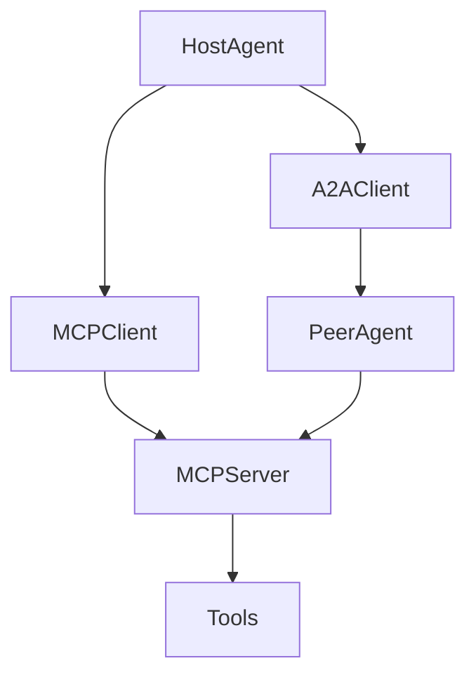

# MCP / A2A Interoperability Kit

Reference architecture for **agent interoperability** using Model Context Protocol (MCP)-style tool servers and agent-to-agent (A2A) messaging patterns.

> Demonstrates how tools and agents should expose typed contracts across process boundaries.

## Architecture Focus

- MCP-style tool server surface (list/call tools)
- A2A task delegation between agents
- Schema validation for tool inputs/outputs
- Capability discovery
- Isolation boundaries for untrusted tools

## High-Level Architecture



## Key Capabilities

| Area | What it shows |
|---|---|
| MCP server | Tool catalog + invoke endpoints |
| MCP client | Discovery and typed invocation |
| A2A | Delegate a task payload to a peer agent |
| Contracts | JSON-schema-like pydantic models |

## Technology Stack

- Python 3.11+
- FastAPI
- Pydantic
- httpx
- pytest

## Setup

```bash
python -m venv .venv
source .venv/bin/activate  # Windows: .venv\Scripts\activate
pip install -r requirements.txt
pytest
uvicorn src.mcp_server.app:app --port 8081 --reload
```

## Example Usage

```python
from src.mcp_client.client import McpClient

client = McpClient("http://127.0.0.1:8081")
tools = client.list_tools()
result = client.call_tool("echo", {"text": "hello agents"})
```

## Security Considerations

- Authenticate server-to-server calls in real deployments
- Constrain tool side effects and network egress
- Validate all tool arguments before execution
- Treat peer-agent output as untrusted

## Known Limitations

- Simplified HTTP stand-in for MCP transport (stdio/SSE not fully implemented)
- A2A message model is intentionally minimal

## License

MIT
